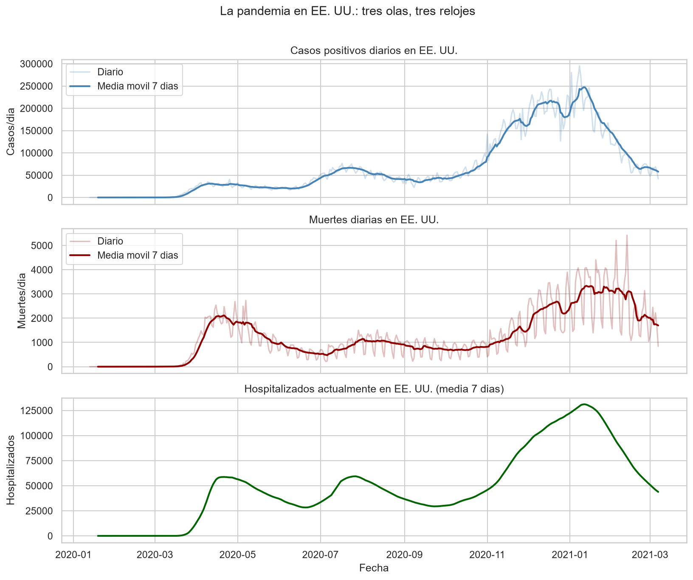
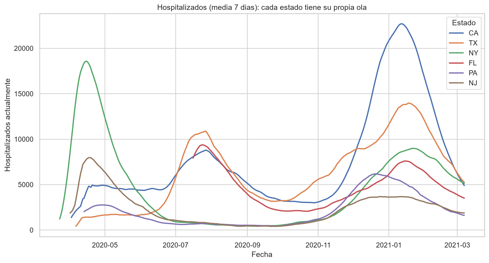
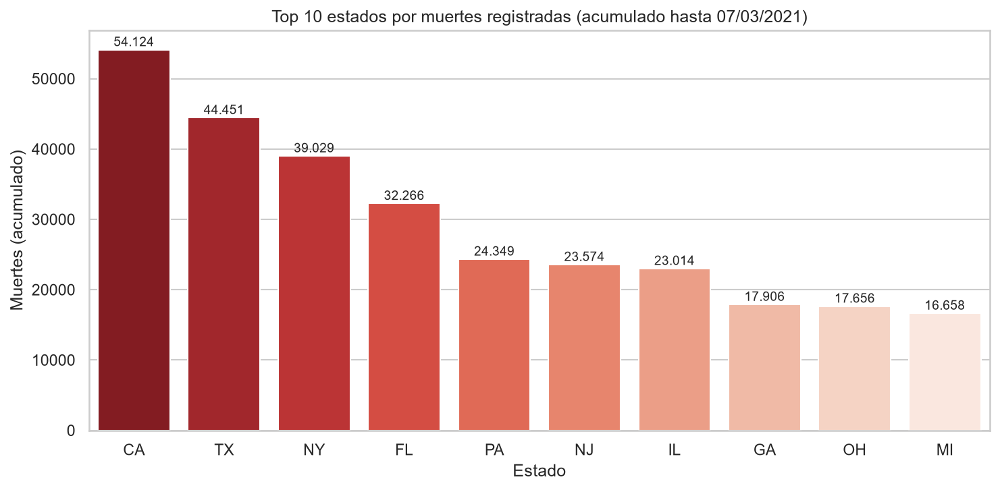
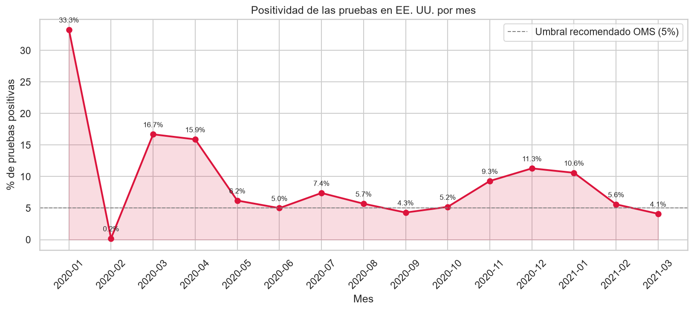
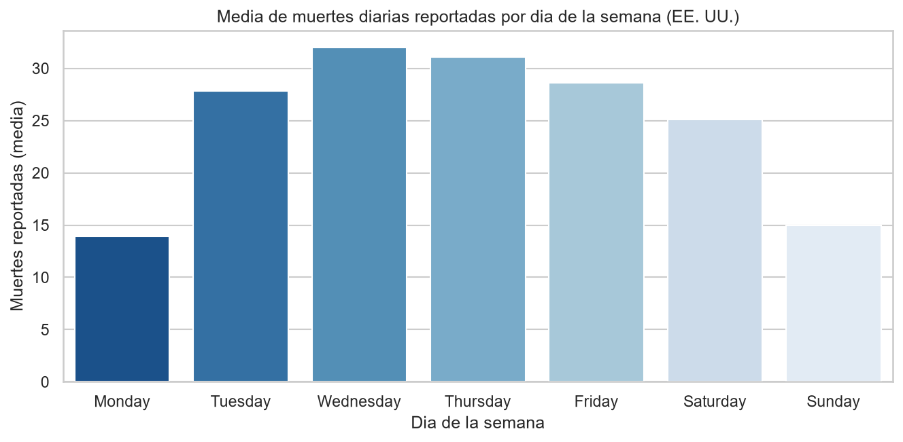
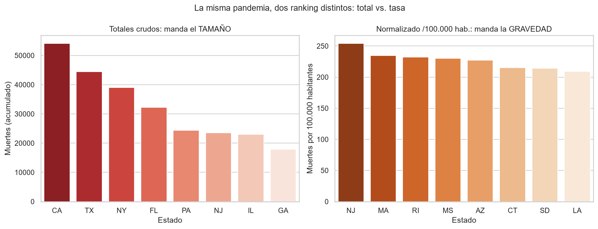
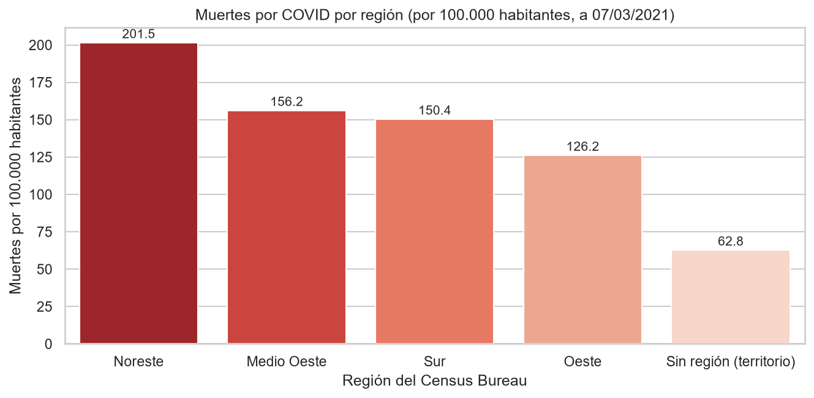

# 📊 Informe ejecutivo: la pandemia de COVID-19 en Estados Unidos

**Datos:** COVID Tracking Project · 56 estados y territorios · 13 de enero de 2020 – 7 de marzo de 2021
**Base:** 20.780 registros diarios, depurados de 56 a 13 variables con criterio (*ver anexo técnico*)

---

## En una frase

> **La pandemia en EE. UU. no fue una ola, sino tres olas distintas que golpearon a cada
> región en su momento.** Y los estados que más testearon no salieron peor parados: los que
> testearon tarde y poco, sí.

---

## 1. Los peores momentos fueron tres, y no coincidieron en todos

La curva nacional muestra tres capítulos claros:

| Ola | Cuándo | Dónde golpeó primero |
|---|---|---|
| 1ª | Primavera 2020 | Nueva York y Nueva Jersey |
| 2ª | Verano 2020 | El sur: Texas, Florida, Arizona |
| 3ª | **Invierno 2020-21 (la mayor)** | Prácticamente todos |

El peor día fue el **11-13 de enero de 2021**: ~247.000 casos y ~3.335 muertes diarias,
con 131.127 hospitalizados simultáneos. La sucesión de los tres picos (casos → hospitalizados →
muertes, con días de diferencia) es la traducción literal de la progresión de la enfermedad.

**Cada estado tuvo su calendario.** Mientras Nueva York colapsaba en abril de 2020, California
estaba casi tranquila; California llegó a su peor momento seis meses después:

---

## 2. ¿Quién lo vivió peor? El tamaño engaña; las tasas no

En totales absolutos mandan **California (54.124 muertes), Texas (44.451) y Nueva York (39.029)**
— pero son los tres estados más poblados. Comparar así es comparar manzanas con naranjas.

Al ajustar con los ratios que creamos (positividad global y muertes por cada 1.000 pruebas),
aparece otra historia: **Georgia (13,9%) y Texas (13,5%)** tuvieron **más del triple** de
pruebas positivas que **Nueva York (4,2%)**. Y en muertes por cada 1.000 pruebas, Nueva York
se queda en **1,0** frente a **2,4 de Georgia** y **2,2 de Texas**: con muertes totales
parecidas en la liga alta (39.029 vs. 17.906 de Georgia), Nueva York detectó muchos más
casos de los que el sur pasó por alto. Los estados del grupo de **muertes altas** tuvieron una
positividad media del **8,9% frente al 6,2%** de los de muertes bajas: **la letalidad detectada
sí distingue grupos; los totales crudos, no.**

---

## 3. Testear más no crea pacientes: revela lo que ya pasaba

La relación medida entre las variables clave:

- Más pruebas → más casos detectados: **correlación 0,92** (relación mecánica: a más esfuerzo
  de testeo, más hallazgo — no al revés).
- Hospitalizados ↔ UCI ↔ respirador: **0,92–0,98**, son la misma variable contada en
  profundidades distintas.
- Cuando la positividad se dispara, los hospitales se llenan **semanas después**:

**Abril de 2020 cerró en 15,9%** de pruebas positivas y **el invierno 2020-21 entre 9,3% y
11,3%**, muy por encima del 5% que la OMS marca como «testeo insuficiente». El verano de 2020
se quedó en torno al 5-7%.

> **Lectura para la dirección:** cada vez que la positividad dobla el 5%, el sistema
> hospitalario recibirá la factura con 2-4 semanas de retraso. Es el indicador adelantado
> más barato que existe.

---

## 4. Un detalle de calidad: los números no se reportan «en vivo»

- **Las muertes no se informan los domingos** (media de 15/día) **y se acumulan el
  miércoles** (32/día): es un efecto administrativo, no biológico. Por eso todo el análisis
  usa medias de 7 días.
- **Hay días con muertes «negativas»** (73 en total): correcciones de registros duplicados,
  no errores. Se conservan y documentan: eliminarlos habría inflado los totales.

---

## 5. ¿Qué se hizo con los datos (y por qué)?

| Problema encontrado | Decisión | Por qué |
|---|---|---|
| 15 columnas con >80% de nulos | Se eliminan | Sus valores no existen: no hay nada que analizar |
| 7 columnas siempre a 0 o vacías | Se eliminan | No varían: no explican nada |
| Nulos al inicio de los acumulados (casos, muertes) | Se rellenan con 0 | «Aún no había registros» — es cierto para un acumulado |
| Huecos de hospitalizaciones **dentro** de la serie | Se rellenan con el último valor conocido | Un paciente no desaparece de un día para otro |
| Hospitalizaciones que un estado dejó de reportar | Se dejan vacías | Rellenar sería inventar pacientes |
| Valores negativos diarios | Se conservan | Son correcciones reales de los estados |
| 2.201 valores atípicos (10,6%) | Se conservan | Son días reales de máximo o correcciones de registro |
| Valores con fecha `20200313` | Se convierten a fecha real | Sin esto no hay análisis temporal |

**Nada de esto se hizo «a ojo»**: cada decisión se calculó y comprobó en el notebook
`notebooks/02_eda_covid_medio.ipynb`, que se ejecuta de principio a fin sin errores.

---

## 6. La comparación definitiva: por cada 100.000 habitantes

Hemos cruzado los datos con el **Census Bureau** (población oficial de cada estado) y el
ranking cambia por completo:

| Por totales | Por cada 100.000 hab. |
|---|---|
| 1. California | 1. **Nueva Jersey (254)** |
| 2. Texas | 2. **Massachusetts (235)** |
| 3. Nueva York | 3. **Rhode Island (232)** |

**California ni siquiera entra en el top-8 de gravedad relativa.** Y por regiones, el
**Noreste (201,5 muertes/100k)** lidera con claridad, por delante del Medio Oeste (156,2),
el Sur (150,4) y el Oeste (126,2).

> **Lectura para la dirección:** centrar recursos donde hay más *personas* no es lo mismo
> que centrarlos donde hay más *riesgo*. El noreste fue la zona más castigada en
> términos relativos — y con diferencia.

*(Mapa interactivo y evolución por región con valores al pasar el ratón: notebook `03`,
sección 5. Requiere ejecutar el notebook para verlos.)*

---

## 7. Recomendaciones

1. **Adoptar la positividad semanal como indicador de alerta** (umbral 5%): tiene 2-4 semanas
   de ventaja sobre las hospitalizaciones.
2. **Nunca comparar estados por totales crudos**; usar tasas por cada 100.000 habitantes —
   el ranking cambia por completo (arriba).
3. **Comunicar las cifras con medias de 7 días**: los datos diarios mienten por calendario
   administrativo (fines de semana y festivos).
4. **Tratar los «datos imposibles» como información, no como basura**: los acumulados que
   bajan (73 días de muertes negativas) son correcciones reales; borrarlos habría inflado
   los totales. Documentados en el notebook 03.

---

*Anexo técnico — para quien quiera revisar el cómo: notebook `01_eda_covid.ipynb` (carga y
diagnóstico), `02_eda_covid_medio.ipynb` (limpieza justificada, outliers, variables nuevas,
agrupaciones, correlación y series temporales) y `03_eda_covid_avanzado.ipynb` (normalización,
Census Bureau, calidad de datos, escala logarítmica, regiones y gráficos plotly). La limpieza
vive en `src/limpieza.py` (reutilizable). Datos en `data/processed/`.*
